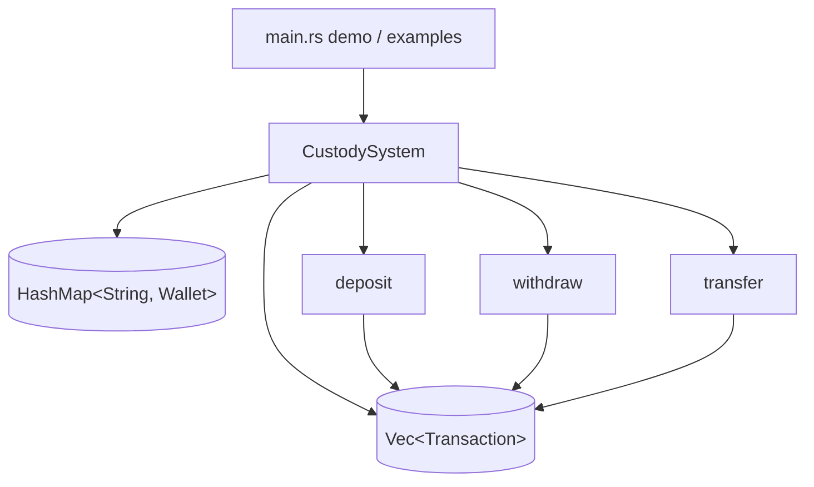

# 🔒 SecureVault

> In-memory cryptocurrency custody ledger in Rust: hot/cold wallet separation, deposits, withdrawals, transfers and a per-wallet transaction audit trail. A small, well-tested library plus a demo binary — **not** a secrets manager and **not** production-ready custody software.


[English](#english) | [Português](#português)

---

## English

### What it is

`securevault` is a single-crate Rust library (`src/lib.rs`, ~230 lines of code plus ~40 unit tests) that models a custody ledger:

- `Wallet` with an `id`, `address`, `balance` and `WalletType::{Hot, Cold}`
- `CustodySystem`, an in-memory `HashMap` of wallets plus an append-only `Vec<Transaction>`
- `deposit`, `withdraw` and `transfer` with validation (positive amounts, existing wallets, sufficient funds)
- Query helpers: `get_wallet`, `get_all_wallets`, `get_total_balance`, `get_wallet_transactions`, `get_all_transactions`

`src/main.rs` is a demo that creates two wallets, moves funds between them and prints the history.

### What it is *not*

Earlier versions of this README advertised AES-256 encryption, JWT authentication, RBAC, key rotation and rate limiting. **None of that exists in the code.** There is no persistence, no network layer, no cryptography and no access control. Treat this repository as a study of a clean domain model with good test coverage, nothing more.

Balances use `f64`. Floating-point math is not exact, so this is unsuitable for real money; a production ledger would use integer units (satoshis/wei) or a fixed-precision decimal type.

### Architecture



The sequence diagram in [`docs/security_flow.mmd`](docs/security_flow.mmd) walks through a deposit/withdraw/transfer cycle.

### Quick start

```bash
git clone https://github.com/galafis/securevault.git
cd securevault
cargo run --release            # demo binary
cargo run --example basic      # or: error_handling, transaction_history, transfer
cargo test                     # unit + integration + doc tests
```

Requires Rust 1.75+ (edition 2021). The only dependency is `serde`.

### Library usage

```rust
use securevault::{CustodySystem, WalletType};

let mut system = CustodySystem::new();
system.create_wallet("hot".into(), "0xabc".into(), WalletType::Hot)?;
system.create_wallet("cold".into(), "0xdef".into(), WalletType::Cold)?;
system.deposit("hot", 10.0)?;
system.transfer("hot", "cold", 4.0)?;
assert_eq!(system.get_wallet("cold").unwrap().balance, 4.0);
# Ok::<(), String>(())
```

Errors are returned as `Result<_, String>`; nothing panics on invalid input.

### Project structure

```
securevault/
├── .github/workflows/ci.yml   # fmt, clippy -D warnings, tests, example run
├── docs/                      # Mermaid diagrams (+ rendered PNGs)
├── examples/                  # basic, error_handling, transaction_history, transfer
├── src/lib.rs                 # Wallet, Transaction, CustodySystem (+ unit tests)
├── src/main.rs                # demo binary
├── tests/test_main.rs         # integration tests through the public API
├── Cargo.toml                 # serde only
└── Dockerfile                 # builds and runs the demo binary
```

### Development

```bash
cargo fmt --all --check
cargo clippy --all-targets -- -D warnings
cargo test --all-targets
```

CI runs exactly these commands on every push and pull request.

### Roadmap (if this ever grows up)

1. Replace `f64` with integer base units or `rust_decimal`.
2. Persist the ledger (SQLite or an append-only file) instead of `HashMap`.
3. Only then consider encryption at rest and authenticated access.

### License

MIT — see [LICENSE](LICENSE).

---

## Português

### O que é

`securevault` é uma biblioteca Rust de um único crate (`src/lib.rs`, ~230 linhas de código e ~40 testes unitários) que modela um ledger de custódia:

- `Wallet` com `id`, `address`, `balance` e `WalletType::{Hot, Cold}`
- `CustodySystem`, um `HashMap` em memória de carteiras mais um `Vec<Transaction>` só de acréscimo
- `deposit`, `withdraw` e `transfer` com validação (valores positivos, carteiras existentes, saldo suficiente)
- Consultas: `get_wallet`, `get_all_wallets`, `get_total_balance`, `get_wallet_transactions`, `get_all_transactions`

`src/main.rs` é uma demo que cria duas carteiras, move fundos entre elas e imprime o histórico.

### O que *não* é

Versões anteriores deste README anunciavam criptografia AES-256, autenticação JWT, RBAC, rotação de chaves e rate limiting. **Nada disso existe no código.** Não há persistência, camada de rede, criptografia nem controle de acesso. Trate este repositório como um estudo de modelo de domínio limpo e bem testado, nada além disso.

Os saldos usam `f64`. Aritmética de ponto flutuante não é exata, então isso não serve para dinheiro de verdade; um ledger de produção usaria unidades inteiras (satoshis/wei) ou um tipo decimal de precisão fixa.

### Início rápido

```bash
git clone https://github.com/galafis/securevault.git
cd securevault
cargo run --release            # binário de demonstração
cargo run --example basic      # ou: error_handling, transaction_history, transfer
cargo test                     # testes unitários, de integração e de doc
```

Requer Rust 1.75+ (edição 2021). A única dependência é `serde`.

### Desenvolvimento

```bash
cargo fmt --all --check
cargo clippy --all-targets -- -D warnings
cargo test --all-targets
```

O CI executa exatamente esses comandos a cada push e pull request.

### Roadmap (se um dia isso crescer)

1. Trocar `f64` por unidades inteiras ou `rust_decimal`.
2. Persistir o ledger (SQLite ou arquivo só de acréscimo) em vez de `HashMap`.
3. Só então pensar em criptografia em repouso e acesso autenticado.

### Licença

MIT — veja [LICENSE](LICENSE).
